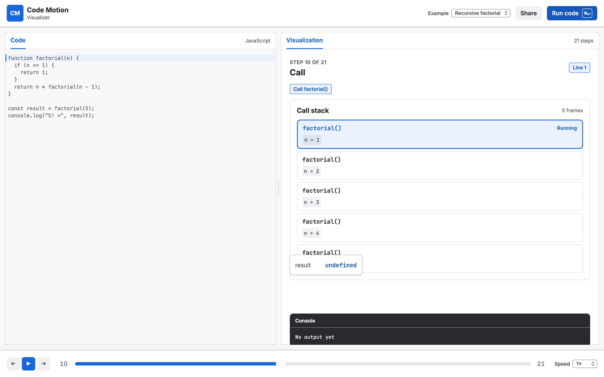

# Code Motion Visualizer

> Watch JavaScript run, step by step. A browser-only visualizer that animates variables, loops, branches, arrays and the call stack, built for people learning to code.




Write JavaScript in the editor, or pick a preset, then press **Run**. The visualizer traces the program inside an isolated Web Worker. You can then play, step or scrub through every state the program went through. There is no backend, no account and no tracking, and everything runs in your browser.

## Table of contents

- [Features](#features)
- [Quick start](#quick-start)
- [Usage](#usage)
- [Supported JavaScript](#supported-javascript)
- [How it works](#how-it-works)
- [Project structure](#project-structure)
- [Scripts](#scripts)
- [Design system](#design-system)
- [Contributing](#contributing)
- [Roadmap](#roadmap)
- [License](#license)

## Features

- **Step-by-step playback:** run, step forward and back, play or pause, change the speed, or scrub the timeline.
- **Visual stage:** shows variable boxes, loop badges with condition results, and array rows with index pointers.
- **Animated changes:** swaps, inserts, and push/pop animate on the array rows.
- **Branches and call stack:** the taken `if`/`else` branch lights up, and the call stack follows functions and recursion.
- **Synced console:** `console.log` output follows the current step.
- **Safe execution:** user code runs only in a Web Worker. A 5,000-step cap and a 2-second timeout keep the tab responsive, even with infinite loops.
- **Shareable links:** the source is encoded in the URL hash, so a link reopens the same program.
- **Offline build:** a single self-contained HTML file works without a network.
- **Accessible motion:** respects `prefers-reduced-motion`.
- **Design tokens:** all visual values are generated from Atlassian's `DESIGN.md`.

## Quick start

Requirements: [Bun](https://bun.com) **1.4 or newer**. The project is developed on macOS (Apple Silicon).

```bash
git clone https://github.com/andynur/codemotion.git
cd codemotion
bun install
bun run dev
```

Open <http://localhost:3000>. The dev server uses Bun HTML imports with hot module reloading.

## Usage

1. Choose a preset, or type your own program in the left panel.
2. Press **Run** (or `Cmd/Ctrl + Enter`).
3. Explore the trace with the toolbar or the keyboard.

| Key | Action |
|---|---|
| `Cmd/Ctrl + Enter` | Run the program |
| `←` / `→` | Step back / forward (when the editor is not focused) |
| `Space` | Play / pause (when the editor is not focused) |

Built-in presets: Sum an array, Find maximum, Reverse an array, Bubble sort, FizzBuzz 1–15, and Recursive factorial.

To share a program, copy the page URL after running it. The source is stored in the hash as base64url.

## Supported JavaScript

The tracer supports a teaching-focused subset of JavaScript:

| Supported | Not supported yet |
|---|---|
| `let`, `const`, `var` | Arrow functions, function expressions |
| Numbers, strings, booleans, arrays | Nested functions and closures |
| Arithmetic and comparison operators | Classes |
| `if` / `else`, `for`, `while`, `for...of` | `async` / `await`, generators |
| `break`, `continue` | `try` / `catch` |
| `console.log` | Nested object literals |
| `push`, `pop`, `shift`, `unshift`, `splice`, `length`, `indexOf`, `includes` | |
| Named top-level functions, parameters, `return`, recursion | |

Unsupported syntax produces a friendly error with the source line.

## How it works

The design is **trace first, animate later.**

```
source ──▶ Acorn parse ──▶ instrument (acorn-walk + astring) ──▶ Web Worker execute
                                                                     │
                     Stage renderer ◀── trace[currentStep] ◀── Step[] (immutable snapshots)
```

1. **Parse:** Acorn turns the source into an AST and validates the supported subset.
2. **Instrument:** trace hooks (`__t`) are injected around statements, assignments, loop tests, branch choices and array mutations. Astring regenerates the code.
3. **Execute:** a dedicated Web Worker runs the instrumented code with a step cap. The main thread terminates the worker if it exceeds the wall-clock timeout.
4. **Render:** each `Step` is a deep-cloned snapshot `{ id, line, col, kind, scopes, heap, event }`. React renders only the selected step, and Motion animates the difference between consecutive steps.

Playback, stepping and scrubbing change only `currentStep`, so going backwards is free.

## Project structure

```
.
├── server.ts             # Bun.serve dev server (HTML import + HMR)
├── scripts/
│   ├── gen-tokens.ts     # DESIGN.md frontmatter → src/styles/tokens.css
│   ├── build-single.ts   # single-file offline HTML build
│   └── smoke.ts          # Bun.WebView end-to-end smoke test
├── src/
│   ├── app/              # layout, toolbar, share link
│   ├── editor/           # CodeMirror 6 wrapper, active-line highlight
│   ├── tracer/           # instrument, runtime, worker, types, tests
│   ├── stage/            # visual primitives and motion.ts
│   ├── playback/         # currentStep, play/pause, speed
│   ├── presets/          # example programs
│   └── styles/           # tokens.css (generated), global.css
├── docs/                 # PRD and dependency decisions
├── DESIGN.md             # Atlassian design spec (token source)
└── AGENTS.md             # rules for coding agents
```

## Scripts

| Command | Description |
|---|---|
| `bun run dev` | Start the dev server with HMR on port 3000 |
| `bun test` | Run tracer unit and snapshot tests |
| `bun test --parallel` | Run the tests in parallel (final gate) |
| `bun run build` | Production build to `dist/`, including the worker and `dist/metafile.md` |
| `bun run build:single` | Self-contained offline file at `dist/code-motion.html` |
| `bun run smoke` | WebView smoke test against `localhost:3000`; screenshots go to `artifacts/` |
| `bun run tokens` | Regenerate `src/styles/tokens.css` from `DESIGN.md` |

The smoke test needs the dev server to be running. It runs Bubble Sort, then checks stepping, playback, scrubbing, the narrow layout, and the step limit on an infinite loop.

## Design system

The UI follows Atlassian's [DESIGN.md](DESIGN.md) with a Jira-like look. `bun run tokens` parses its YAML frontmatter with `Bun.YAML.parse` and emits CSS custom properties.

- Use only values from `src/styles/tokens.css`. Never hard-code colors, spacing, radii, shadows or durations.
- All Motion transitions come from [src/stage/motion.ts](src/stage/motion.ts).
- Inter and JetBrains Mono stand in for Atlassian Sans and Atlassian Mono.

## Contributing

Contributions are welcome. Before opening a pull request:

1. Read [AGENTS.md](AGENTS.md) and [DESIGN.md](DESIGN.md).
2. Keep the bundle lean. Prefer Bun built-ins, and justify any new package in [docs/DEPENDENCIES.md](docs/DEPENDENCIES.md). Open an issue first for packages outside the allowlist.
3. Never evaluate user code on the main thread. Keep stage components pure functions of the selected step.
4. Add or update tests in `src/tracer/*.test.ts` for tracer changes.
5. Make sure `bun test` and `bun run build` pass.
6. Keep commits small. [Conventional Commits](https://www.conventionalcommits.org) are preferred, for example `feat(tracer): support arrow functions`.

Bug reports are most useful with a minimal program that reproduces the problem. A share link works well.

## Roadmap

- [ ] Arrow functions and function expressions
- [ ] Closures and nested scopes, with environment visuals
- [ ] Nested objects and a heap view with references
- [ ] Dark theme
- [ ] Video or GIF export of a trace
- [ ] Guided lessons written in Markdown
- [ ] CI and static hosting

See [docs/PRD.md](docs/PRD.md) for the full product requirements and work plan.

## License

No license has been chosen yet. Until a `LICENSE` file is added, all rights are reserved by the author.

## Acknowledgements

- [Bun](https://bun.com) for the runtime, bundler, test runner and WebView
- [CodeMirror 6](https://codemirror.net) for the editor
- [Motion](https://motion.dev) for animation
- [Acorn](https://github.com/acornjs/acorn) and [Astring](https://github.com/davidbonnet/astring) for parsing and code generation
- [Atlassian Design System](https://atlassian.design) for the design tokens
